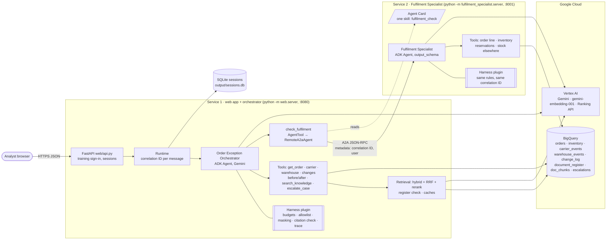
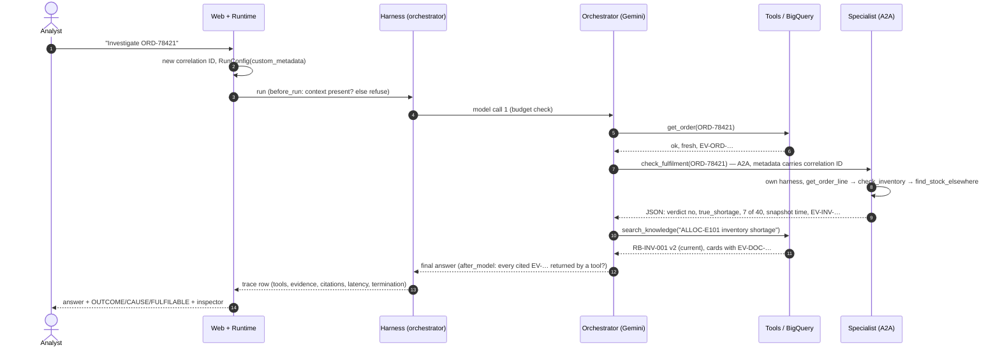
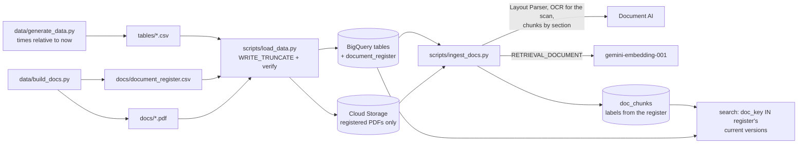

# Architecture

> Code paths on this page are relative to [`retail-control-tower/`](retail-control-tower/).

An analyst asks why an order is delayed. The **Order Exception Orchestrator** investigates live order, carrier, warehouse and change data in BigQuery, asks the **Fulfilment Specialist** over A2A whether the assigned warehouse can fulfil the order, uses runbooks and postmortems as guidance, and answers with cited evidence, or says what to check next.

The reasoning behind each choice is in the capstone design doc ([decision matrix and Gates 1–14](../02-Retail-Order-Exception-Supply-Chain-Control-Tower.md)). This page shows how the parts fit together.

## 1. Components



| Part | Code | Comes from |
|---|---|---|
| Web app, sign-in, sessions | `web/`, `orchestrator/identity.py`, `orchestrator/sessions.py`, `orchestrator/runtime.py` | s16–17 |
| Orchestrator agent | `orchestrator/order_exception_agent/agent.py` | s13, s17, s19 |
| Orchestrator tools | `orchestrator/tools/` | s13 tools + errors |
| Retrieval | `orchestrator/retrieval/` | s8 rag_runtime |
| A2A client | `orchestrator/a2a_client.py` | s19 consumer |
| Fulfilment Specialist | `fulfilment_specialist/` | s19 specialist |
| Harness (both services) | `common/harness/` | s13 harness |
| Result contract, freshness, masking, clients | `common/` | s8, s13 |

**Rule:** the specialist imports nothing from `orchestrator/` (a test checks this). The two services share only `common/` and talk only over A2A.

## 2. One investigation, end to end



The orchestrator picks the checks from the order: a shipped order goes to carrier events and never to the specialist; ALLOC-E107 goes to the change log and the before/after comparison; a stuck PICKING order goes to warehouse events.

## 3. Failure paths

| What fails | What happens | Where |
|---|---|---|
| Specialist down or slower than 30 s | `check_fulfilment` returns an error result; answer is OUTCOME partial, "fulfilment check unavailable", no stock figure | `orchestrator/a2a_client.py` |
| Specialist reply breaks the contract | Treated as unavailable (never half-trusted) | `parse_reply()` |
| Inventory snapshot stale | `can_fulfil = null`, verdict unknown; numbers shown only as stale | `fulfilment_specialist/tools/inventory.py` |
| No inventory row | "No record", explicitly not zero stock | same |
| Order and carrier disagree | OUTCOME escalate; escalation draft waits for the analyst | instruction + `escalate_case` |
| Nothing relevant in the documents | `no_evidence`; the agent says the documents don't cover it | `orchestrator/retrieval/search.py` |
| Model loops, too many tools, failures | Soft stop: tools are blocked and the model gets one closing call to answer from the evidence it has | `common/harness/plugin.py` |
| Model budget nearly used | Tools stop one model call early, so the last call writes the answer | same |
| Model budget used, out of time, or the closing call asks for more tools | Hard stop: no more model calls; the answer is the stop message with the correlation ID | same |
| Request without correlation ID (e.g. ADK Web) | Refused before any model or tool call | `before_run_callback` |
| Answer cites an ID no tool returned | Flagged as unverified in the UI, trace and evals | `after_model_callback` |
| Unexpected exception | Controlled message with the correlation ID; nothing concluded | `orchestrator/runtime.py` |

## 4. Data and documents



- **The register is the source of truth for document metadata** (ID, version, status, dates). It is the upload allowlist, the ingest work list and the label source for every chunk. Metadata never comes from the PDF.
- **Status is checked at question time.** Chunks carry a status snapshot, but search reads the register's list of current versions (at most 60 s old) and keeps only those chunks, so a superseded or withdrawn runbook disappears at once, before any re-ingest. The register's fingerprint is part of the retrieval cache key.
- **A new runbook version in production:** the document system publishes the PDF and updates the register (new row current, old row superseded); a scheduled ingest picks up changed MD5s; until then, the register check already hides the old version.
- Operational data is never embedded: exact times and quantities decide the answer.

## 5. Security and privacy

- Customer name, phone and address never leave the orders table: no tool returns them. Payment status is returned only by the orchestrator's order tool, and masked in logs.
- Logs, traces and session views are masked before writing. Analysts appear as salted hashes (`analyst_…`), never by email.
- Read-only by design. The one write (an escalation row) needs the analyst's explicit confirmation and is idempotent.
- Training sign-in is identification, not authentication: production puts IAP in front and takes the user from the verified token.

## 6. Observability

One correlation ID per analyst message, created by the web runtime, carried in RunConfig, forwarded in the A2A request metadata, and logged by both harnesses. When the analyst answers an escalation confirmation, the resumed run gets a new correlation ID whose `parent_correlation_id` is the run that asked:

```bash
grep corr-3f9a1c2b7d4e output/logs/*.jsonl output/traces/*.jsonl
```

Each service writes one trace row per invocation (`output/traces/<service>.jsonl`): tools and their outcomes, evidence IDs and citations, retrieval strategy, documents and cache hit or miss, A2A outcome and latency, model and tool calls, token totals, whether a closing call or a hard stop happened, and the termination reason. The web inspector shows the same row.
